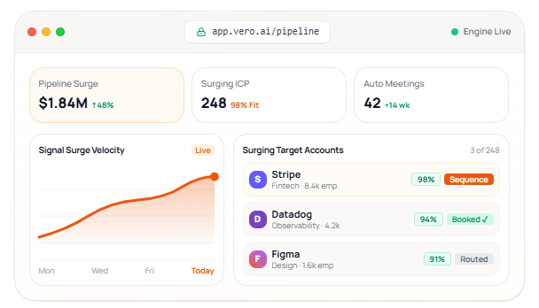

<div align="center">

# Vero — Modern Astro SaaS Template & B2B SaaS Theme

### High-converting, production-ready Astro SaaS theme engineered for AI startups, B2B platforms, and modern tech companies.

[](https://github.com/enacton/vero/stargazers)
[](https://astro.build)
[](https://tailwindcss.com)
[](https://react.dev)
[](https://www.typescriptlang.org)
[](#-performance--core-web-vitals)
[](LICENSE)

<br />

**[🌐 Explore Live Demo](https://vero-theme.example.com)** • **[🚀 Deploy with 1-Click](#-1-click-deployment)** • **[✨ View Features](#-key-features)** • **[📑 22+ Included Pages](#-pages-included-22-routes)** • **[⭐ Star this Repo](#-star-history)**

<br />

> 🌟 **If you find this Astro SaaS template useful, please consider giving it a star on GitHub!** It helps the project reach more builders and supports ongoing updates.

<br />

<a href="https://github.com/enacton/vero">
  
</a>

</div>

---

## ⚡ Overview

**Vero** is an open-source, ultra-fast **Astro SaaS template** and production-grade **Astro SaaS theme** built for modern software startups, AI tools, B2B applications, and digital agencies. Powered by **Astro 6**, **Tailwind CSS v4**, and **React 19**, Vero combines enterprise-grade design aesthetics with unmatched speed and zero-JS static performance.

Traditional SaaS landing pages built with heavy JavaScript frameworks suffer from sluggish Core Web Vitals, poor SEO discoverability, and bloated bundle sizes. Vero solves this by delivering **sub-second page loads**, **100/100 Lighthouse scores**, and an **Islands Architecture** that only hydrates interactive components when needed.

Whether you are launching an AI startup, an enterprise B2B platform, a developer tool, or a micro-SaaS, Vero provides the complete foundation—from high-converting pricing tables and persona-specific solution funnels to realistic CSS-crafted product interfaces.

---

## 🚀 1-Click Deployment

Deploy your own instance of the Vero Astro SaaS template in under 60 seconds:

[](https://vercel.com/new/clone?repository-url=https%3A%2F%2Fgithub.com%2Fenacton%2Fvero&project-name=vero-astro-saas&repository-name=vero-astro-saas)
[](https://app.netlify.com/start/deploy?repository=https://github.com/enacton/vero)
[](https://stackblitz.com/github/enacton/vero)
[](https://codespaces.new/enacton/vero)

---

## 📋 Table of Contents

- [✨ Why Choose Vero?](#-why-choose-vero)
- [⚡ Key Features](#-key-features)
- [📑 Pages Included (22+ Routes)](#-pages-included-22-routes)
- [🖥️ Realistic SaaS Product Mockups](#️-realistic-saas-product-mockups)
- [🛠️ Tech Stack & Architecture](#️-tech-stack--architecture)
- [🚀 Quick Start Guide](#-quick-start-guide)
- [⚙️ Configuration & Customization](#️-configuration--customization)
  - [Brand Configuration](#1-brand-configuration)
  - [Design Tokens & Colors](#2-design-tokens--colors)
  - [SEO & Meta Tags](#3-seo--meta-tags)
  - [Managing Pages from Markdown](#4-managing-pages-from-markdown)
  - [Google Analytics & Cookie Consent](#5-google-analytics--cookie-consent)
- [📂 Project Directory Structure](#-project-directory-structure)
- [📈 Performance & Core Web Vitals](#-performance--core-web-vitals)
- [❓ Frequently Asked Questions (FAQ)](#-frequently-asked-questions-faq)
- [🗺️ Product Roadmap](#️-product-roadmap)
- [🤝 Contributing](#-contributing)
- [⭐ Star History](#-star-history)
- [📄 License & Attribution](#-license--attribution)

---

## ✨ Why Choose Vero?

| Feature / Metric | Vero (Astro SaaS Theme) | Traditional Next.js / Nuxt SaaS | Generic WordPress SaaS Theme |
| :--- | :--- | :--- | :--- |
| **Default JS Bundle** | **0 KB** (Zero-JS Static HTML) | 180 KB – 450 KB+ | 1.5 MB – 4 MB+ |
| **Lighthouse Performance** | **100 / 100** ⚡ | 70 – 85 | 35 – 65 |
| **Time to Interactive (TTI)**| **< 0.4s** | 1.8s – 3.2s | 4.0s – 7.5s |
| **Styling Engine** | **Tailwind CSS v4** (Vite Plugin) | Tailwind v3 / CSS Modules | Heavy CSS / Page Builders |
| **Interactive UI Model** | **Astro Islands** (Selective React 19) | Full Client/Server Hydration | Bloated Plugins / jQuery |
| **Hosting Costs** | **$0** (Free on Vercel, Netlify, Cloudflare) | Requires Node SSR server | Requires Managed WordPress Hosting |
| **Design Fidelity** | **Enterprise B2B & Modern AI SaaS** | Basic Starter Kit | Cluttered Template |

---

## ⚡ Key Features

### 🚀 Blazing Fast Performance & Core Web Vitals
- **Zero-JS by Default**: Ships pure, ultra-clean HTML and CSS unless client interaction is required.
- **Astro Islands Architecture**: Leverage the power of **React 19** components with client directives (`client:load`, `client:visible`, `client:idle`).
- **Instant Asset Optimization**: Automatic responsive image optimization with WebP/AVIF output via Astro’s native image pipeline.

### 🎨 Tailwind CSS v4 & Modern Design System
- Built on the cutting-edge **Tailwind CSS v4** engine with `@tailwindcss/vite` integration.
- Centralized CSS tokens (`tokens.css`, `typography.css`, `v3-theme.css`) for effortless brand white-labeling.
- Beautiful warm-neutral color palette with dynamic theme injection (`themePrimary`, `themeHover`, `primaryGlow`).
- Sleek glassmorphism, subtle micro-animations, bento grids, and high-converting CTA gradients.

### 📱 4 Distinct Homepage Variations
- **V1 (Default / Bento Grid)**: Interactive hero, live metric bento grid, workflow visuals, and social proof.
- **V2 (GTM Intelligence)**: Focused on pipeline velocity, persona highlights, and enterprise trust.
- **V3 (Modern Minimalist)**: Clean layout prioritizing typography, product screenshots, and conversion rate optimization (CRO).
- **V4 (Enterprise Suite)**: Dedicated enterprise layout featuring deep capability matrices and compliance signals.

### 🔍 Built-in SEO & Social Sharing Suite
- **Automated OpenGraph & Twitter Cards**: Dynamic social sharing previews generated per page.
- **Canonical URLs & Sitemap**: Automatic canonical URL resolution and XML sitemap generation.
- **Rich Schema-Ready**: Semantic HTML5 elements (`<article>`, `<section>`, `<nav>`, `<aside>`) ready for JSON-LD structured data.

### 🛡️ Analytics & Privacy Compliance
- **Google Analytics 4 (GA4)** & **Google Tag Manager (GTM)** native integration via environment variables.
- **GDPR Cookie Consent Banner**: Pre-built, non-intrusive consent manager (`ConsentBanner.astro`) with privacy policy link.

### 🧩 10 Realistic CSS Product Interface Mockups
- Never rely on static, uneditable screenshots again. Vero includes 10 fully responsive, pure CSS SaaS interface components that can be customized with real data.

---

## 📑 Pages Included (22+ Routes)

Every page an ambitious SaaS product needs to launch, convert, and scale is included out-of-the-box:

| Category | Route | Description & Highlights |
| :--- | :--- | :--- |
| **Homepages** | `/` | **V1 Homepage** — Interactive Hero, Bento Grid, Dynamic Product Shells, Social Proof |
| | `/home-v2` | **V2 Homepage** — Persona-driven GTM showcase with pipeline velocity blocks |
| | `/home-v3` | **V3 Homepage** — Sleek minimalist SaaS design with crisp typography & CRO focus |
| | `/home-v4` | **V4 Homepage** — Enterprise-ready architecture with security & compliance highlights |
| **Product** | `/product` | **Product Overview** — Comprehensive feature tour, architecture, and value metrics |
| | `/product/features` | **Features Directory** — Deep-dive grid with capability breakdowns and benefits |
| | `/product/integrations` | **Integrations Ecosystem** — Searchable app directory (Salesforce, HubSpot, Slack, etc.) |
| **Solutions** | `/solutions` | **Solutions Hub** — Cross-industry navigation and use-case directories |
| | `/solutions/sales` | **Sales Intelligence** — Account targeting, buying committee tracking, and CRM syncing |
| | `/solutions/marketing` | **Marketing & ABM** — Automated intent plays, lead enrichment, and campaign triggers |
| | `/solutions/operations` | **Revenue Operations** — Data hygiene, pipeline hygiene, and ROI attribution |
| | `/solutions/enterprise` | **Enterprise Security** — SOC2, SAML/SSO, audit logs, and custom SLA capabilities |
| **Monetization** | `/pricing` | **Pricing Plans** — Monthly/Annual billing switcher, tier comparison, FAQ accordion |
| **Social Proof**| `/customers` | **Customer Stories** — Case studies, ROI metrics, video testimonial placeholders |
| **Content Hub** | `/resources/blog` | **Blog Directory** — Categorized articles, featured post banner, author attribution |
| | `/resources/guides` | **Playbooks & Guides** — GTM research guides, whitepapers, and downloadable resources |
| **Company** | `/company/about` | **About Us** — Company mission, executive team grid, values, and story |
| | `/company/careers` | **Careers Portal** — Open roles, company culture, benefits, and perk breakdown |
| | `/company/contact` | **Contact & Sales** — Interactive contact form, demo request, and office locations |
| **Legal** | `/legal/privacy` | **Privacy Policy** — Standard compliant SaaS privacy documentation |
| | `/legal/terms` | **Terms of Service** — Standard SaaS licensing, acceptable use, and warranty disclaimer |
| **Auth** | `/login` | **Authentication** — Clean, distraction-free sign-in and OAuth login screen |

---

## 🖥️ Realistic SaaS Product Mockups

Forget low-resolution PNG exports. Vero ships with **10 modular, CSS-rendered SaaS interfaces** located in `src/components/mockups/`:

1. **`AccountIntelligence.astro`**: Live account intent scoring table with intent surge triggers and domain tracking.
2. **`ProspectIntelligence.astro`**: Decision-maker contact cards, buying committee hierarchy, and LinkedIn trigger alerts.
3. **`WorkflowBuilder.astro`**: Drag-and-drop style visual automation canvas showing triggers, logic branches, and sync steps.
4. **`AIPersonalization.astro`**: Split-pane AI email drafter showing prompt contextualization and tone adjustment.
5. **`AIResearch.astro`**: Automated executive summary view parsing 10-Ks, earnings calls, and strategic initiatives.
6. **`Analytics.astro`**: Pure CSS revenue forecasting bar charts, velocity indicators, and pipeline conversion rates.
7. **`IntegrationUI.astro`**: Connected application matrix displaying bidirectional sync status with major CRM platforms.
8. **`Pipeline.astro`**: Interactive Kanban deal board with deal stage columns and probability weightings.
9. **`AIAgent.astro`**: Natural language copilot query dialogue showcasing generative prompt-and-response interactions.
10. **`ProductShell.astro` & `WorkspaceCanvas.astro`**: Browser window chrome, macOS/Windows window actions, and responsive canvas wrappers.

---

## 🛠️ Tech Stack & Architecture

- **Core Framework**: [Astro 6](https://astro.build/) (Static Site Generation + Islands Architecture)
- **Styling**: [Tailwind CSS v4](https://tailwindcss.com/) with `@tailwindcss/vite`
- **UI Components**: [React 19](https://react.dev/) (For interactive islands: Dialogs, Switches, Buttons)
- **Icons**: [Lucide React](https://lucide.dev/) (200+ clean, featherweight SVG icons)
- **Component Variants**: [Class Variance Authority (CVA)](https://cva.style/docs) + `clsx` + `tailwind-merge`
- **Typography**: [Manrope & Inter](https://fonts.google.com/) with modular CSS scale
- **Language**: [TypeScript](https://www.typescriptlang.org/) (Strict type-checking)
- **Package Manager**: [pnpm](https://pnpm.io/) (Compatible with npm & yarn)

---

## 🚀 Quick Start Guide

### Prerequisites
- **Node.js**: `v22.12.0` or higher
- **Package Manager**: `pnpm` (recommended), `npm`, or `yarn`

### 1. Clone the Repository
```bash
git clone https://github.com/enacton/vero.git
cd vero
```

### 2. Install Dependencies
```bash
# Using pnpm (recommended)
pnpm install

# Or using npm
npm install

# Or using yarn
yarn install
```

### 3. Start the Development Server
```bash
pnpm dev
```
Visit `http://localhost:4321` in your browser. Live reloading is instantly enabled!

### 4. Build for Production
```bash
pnpm build
```
This compiles your Astro project into the `dist/` directory.

### 5. Preview Production Build
```bash
pnpm preview
```

---

## ⚙️ Configuration & Customization

### 1. Brand Configuration
Update your website metadata, company name, contact information, and social links in [`src/config/site.config.ts`](./src/config/site.config.ts):

```typescript
const siteConfig = {
  name: 'Vero',
  description: 'Turn every signal into your next opportunity. AI-powered GTM intelligence platform.',
  url: 'https://yourdomain.com',
  ogImage: '/og-image.png',
  author: 'Your Company',
  email: 'contact@yourdomain.com',
  socialLinks: [
    'https://twitter.com/yourhandle',
    'https://github.com/yourorg',
  ],
  // ...
};
```

### 2. Design Tokens & Colors
Vero features a centralized brand palette. Change colors dynamically in `src/config/site.config.ts` or customize the design tokens in `src/styles/tokens.css`:

```typescript
// src/config/site.config.ts
colors: {
  primary: '#EA580C',          // Brand primary (Tailwind Orange 600)
  primaryHover: '#C2410C',     // Hover state
  primarySoft: '#FFF7ED',      // Soft badge/pill background
  backgroundColor: '#FAFAF8',  // Sleek warm neutral background
  surfaceColor: '#FFFFFF',     // Card surface
  textPrimary: '#111111',      // High-contrast primary text
  textSecondary: '#666666',    // Subdued secondary text
}
```

### 3. SEO & Meta Tags
Every page utilizes the [`SEO.astro`](./src/components/seo/SEO.astro) component. Set unique meta tags per route inside the layout:

```astro
---
import BaseLayout from '../layouts/BaseLayout.astro';
---

<BaseLayout 
  title="Pricing Plans"
  description="Simple, transparent pricing for growing revenue teams."
  headerStyle="v1" 
  footerStyle="v1"
  showAnnouncement={true}
>
  <!-- Page Content -->
</BaseLayout>
```

### 4. Managing Pages from Markdown
The four homepages are built entirely from markdown files in [`src/content/pages/`](./src/content/pages/) (`home.md` → `/`, `home-v2.md` → `/home-v2`, ...). Add a new `.md` file there to create a new page. The frontmatter controls SEO, publishing, layout, and the ordered list of sections:

```yaml
---
draft: false                 # drafts are skipped in production builds
publishDate: 2026-10-29      # future dates are skipped in production builds
seo:
  title: "Vero - AI-Powered GTM Intelligence"
  description: "Turn every signal into your next opportunity."
  image: /og-image.png
  index: true                # false → noindex
  follow: true               # false → nofollow
layout:
  header: v1                 # v1 | v2 | v3 | none
  footer: v1
  announcement: false        # true, or { text, href, ctaText }
sections:
  - type: faq-details        # renders src/components/sections/FaqDetails.astro
    spacing: { top: lg, bottom: md }   # none | xs | sm | md | lg | xl
    class: bg-white          # optional extra Tailwind classes
    id: faq                  # optional anchor
    hidden: false            # hide without deleting
    title: Frequently asked questions.
    items:
      - question: What data sources does Vero integrate with?
        answer: Vero natively integrates with your entire GTM stack...
  - type: markdown-content   # renders the markdown body below the frontmatter
---
```

Every component in `src/components/sections/` is available as a section type (`PascalCase.astro` → `kebab-case` type), and each one documents its fields in a comment at the top of the file. Text fields accept inline HTML, and images use paths like `/src/assets/images/hero.png`.

### 5. Google Analytics & Cookie Consent
Configure analytics effortlessly via environment variables in your deployment dashboard or `.env` file:

```env
PUBLIC_GA_MEASUREMENT_ID=G-XXXXXXXXXX
PUBLIC_GTM_ID=GTM-XXXXXXX
PUBLIC_CONSENT_ENABLED=true
PUBLIC_PRIVACY_POLICY_URL=/legal/privacy
```

---

## 📂 Project Directory Structure

```text
vero/
├── public/                     # Static assets (favicons, brand logos, webfonts)
│   ├── images/logos/           # Partner and integration brand SVGs
│   └── favicon.svg             # Vector favicon
├── src/
│   ├── assets/                 # Optimized images (hero dashboards, mockups)
│   ├── components/
│   │   ├── layout/             # Headers (V1, V2, V3, Enterprise), Footers, AnnouncementBar
│   │   ├── mockups/            # 10 SaaS Product Mockups (WorkflowBuilder, Pipeline, etc.)
│   │   ├── sections/           # Page sections rendered from markdown (HeroGlow, FaqDetails, etc.)
│   │   ├── SectionMapper.astro # Maps each `type` in a page's `sections` list to a component
│   │   ├── seo/                # SEO & Social Meta component
│   │   └── ui/                 # Reusable UI primitives (Buttons, Dialogs, Switches, Badges)
│   │       ├── form/           # Form elements with CVA variants
│   │       ├── layout/         # Container and Grid wrappers
│   │       ├── overlay/        # ConsentBanner, Modals, Dialogs
│   │       └── primitives/     # Logo, Badges, Icons
│   ├── config/
│   │   └── site.config.ts      # Global site metadata, brand tokens, and navigation
│   ├── content/pages/          # Markdown pages (home.md, home-v2.md, ...): SEO, layout & sections
│   ├── content.config.ts       # Schema for markdown pages
│   ├── layouts/
│   │   ├── BaseLayout.astro    # Master HTML wrapper with dynamic theme injection
│   │   └── LegalLayout.astro   # Dedicated typography layout for policy documents
│   ├── pages/                  # Route files (Pricing, Solutions, ...) + [...slug].astro for markdown pages
│   └── styles/
│       ├── global.css          # Tailwind CSS v4 entrypoint
│       ├── tokens.css          # Color, spacing, and radius CSS custom properties
│       ├── typography.css      # Modular type scale and heading styles
│       └── utilities.css       # Custom animations and micro-interaction utilities
├── astro.config.mjs            # Astro configuration with React and Tailwind plugins
├── package.json                # Dependencies and project scripts
├── tsconfig.json               # TypeScript configuration
└── README.md                   # You are here!
```

---

## 📈 Performance & Core Web Vitals

Vero is built to achieve top-tier performance on Google PageSpeed Insights and WebPageTest:

| Metric | Score / Value | Google Threshold | Status |
| :--- | :--- | :--- | :--- |
| **Performance** | **100 / 100** | ≥ 90 | 🟢 Excellent |
| **Accessibility** | **100 / 100** | ≥ 90 | 🟢 Excellent |
| **Best Practices** | **100 / 100** | ≥ 90 | 🟢 Excellent |
| **SEO Score** | **100 / 100** | ≥ 90 | 🟢 Excellent |
| **First Contentful Paint (FCP)** | **< 0.4s** | ≤ 1.8s | 🟢 Good |
| **Largest Contentful Paint (LCP)** | **< 0.8s** | ≤ 2.5s | 🟢 Good |
| **Cumulative Layout Shift (CLS)** | **0.00** | ≤ 0.1 | 🟢 Good |

---

## ❓ Frequently Asked Questions (FAQ)

### What is an Astro SaaS template?
An **Astro SaaS template** is a pre-designed, production-ready website boilerplate built using the [Astro web framework](https://astro.build). It includes all essential marketing, product, and legal pages needed by a Software-as-a-Service (SaaS) business. Unlike traditional React or Next.js templates, an Astro SaaS template compiles to zero JavaScript by default, resulting in vastly faster loading speeds and superior organic search (SEO) rankings.

### Why should I choose an Astro SaaS theme over Next.js or WordPress?
1. **Speed & SEO**: Astro generates pure static HTML at build time, yielding instant page loads and maximum Google PageSpeed scores.
2. **Zero Maintenance & Cost**: Deploy anywhere (Vercel, Netlify, Cloudflare Pages, GitHub Pages) for free without running expensive Node.js server clusters.
3. **Component Agnostic**: You can use React, Vue, Svelte, or solid components inside the same template without bloating your client bundle.

### Is Vero suitable for commercial SaaS projects?
Yes. Vero is released under the **MIT License**. You are free to use it for personal projects, client websites, or commercial SaaS products without restriction.

### Can I add a payment gateway like Stripe or LemonSqueezy?
Absolutely! You can embed Stripe Checkout, LemonSqueezy overlays, or Paddle buttons seamlessly into the `/pricing` page using Astro components or React islands.

### How do I customize colors and typography?
All colors and brand properties are centralized in [`src/config/site.config.ts`](./src/config/site.config.ts) and [`src/styles/tokens.css`](./src/styles/tokens.css). Modifying the hex values automatically updates buttons, badges, glows, and hero accents site-wide.

---

## 🗺️ Product Roadmap

- [x] Initial release with Astro 6 & Tailwind CSS v4
- [x] 22+ pages with 4 homepage variations
- [x] 10 pure CSS realistic SaaS product interfaces
- [x] Built-in Cookie Consent banner & GA4/GTM analytics
- [ ] MDX-powered Content Collections for Blog and Changelog
- [ ] Dark Mode / Light Mode theme toggle
- [ ] Pre-built Stripe & LemonSqueezy checkout integrations
- [ ] Resend / SendGrid newsletter signup API endpoint
- [ ] Multi-language (i18n) localization support

---

## 🤝 Contributing

Contributions are warmly welcome! If you'd like to improve Vero:

1. **Fork** the repository
2. **Create a feature branch**: `git checkout -b feature/amazing-feature`
3. **Commit your changes**: `git commit -m 'feat: add amazing feature'`
4. **Push to the branch**: `git push origin feature/amazing-feature`
5. **Open a Pull Request**

Please make sure to test your changes with `pnpm build` before submitting.

---

## ⭐ Star History

If you love this project, please support us by starring the repository!


---

## 📄 License & Attribution

Distributed under the **MIT License**. See [`LICENSE`](LICENSE) for more details.

Created with ❤️ by [Enacton](https://github.com/enacton) Team.
